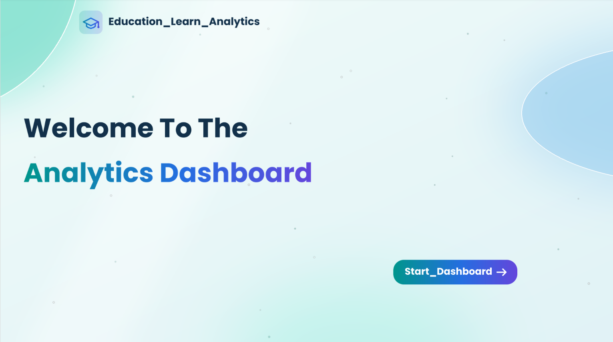
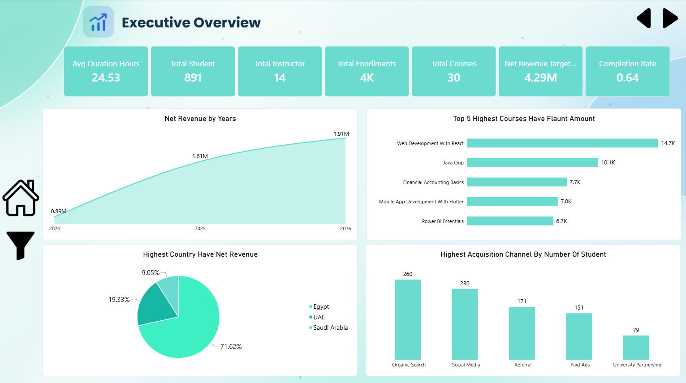
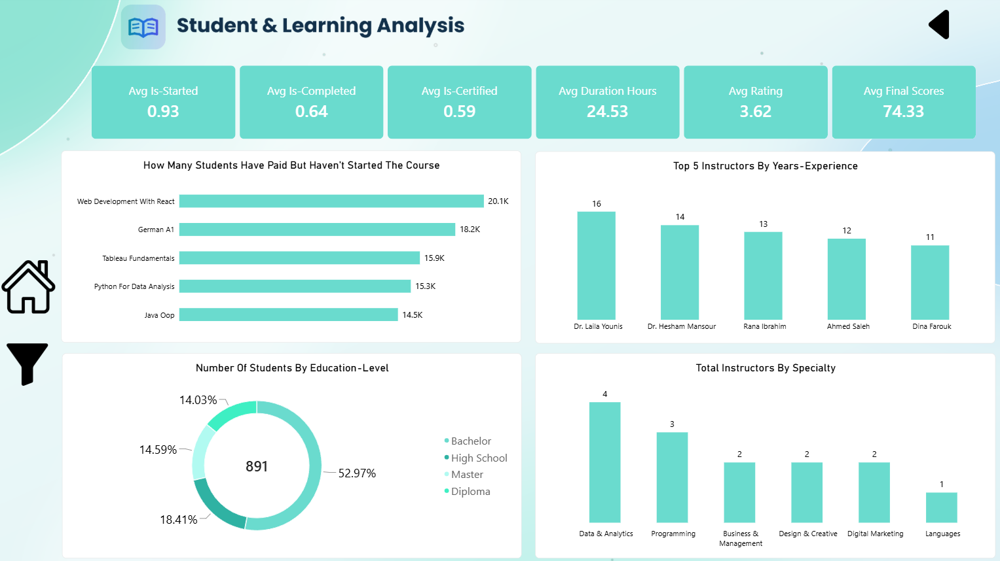

# Education & Learning Analytics | Power BI Dashboard

An interactive Power BI dashboard that analyzes an online learning platform: students, enrollments, learning progress, instructors, courses, and revenue. It also uses **custom report page tooltips** that show extra KPIs and charts when you hover over a visual.

## About the Project

This project turns education platform data into a dashboard that answers questions such as:

- How many students, instructors, courses, and enrollments does the platform have?
- How much net revenue does it generate, and how is it growing over the years?
- How many students start, complete, and get certified in their courses?
- Which countries and acquisition channels bring the most students and revenue?
- Who are the instructors, and which specialties do they cover?

## Tools Used

- Power BI Desktop
- DAX measures (completion rate, average rating, net revenue, refund amount, and more)
- **Custom report page tooltips** (3 tooltip pages)
- Navigation buttons (Home, back and forward) and a filter button
- Custom design with a light teal theme

## Dashboard Pages

### 1. Home

A welcome page with a **Start Dashboard** button that opens the report.

### 2. Executive Overview

**KPIs:** Avg Duration Hours (24.53), Total Students (891), Total Instructors (14), Total Enrollments (4K), Total Courses (30), Net Revenue Target (4.29M), Completion Rate (0.64)

**Visuals:**
- Net Revenue by Years
- Top 5 Courses by Refund Amount
- Highest Countries by Net Revenue
- Highest Acquisition Channels by Number of Students

### 3. Student & Learning Analysis

**KPIs:** Avg Is-Started (0.93), Avg Is-Completed (0.64), Avg Is-Certified (0.59), Avg Duration Hours (24.53), Avg Rating (3.62), Avg Final Scores (74.33)

**Visuals:**
- Students Who Have Paid but Haven't Started the Course
- Top 5 Instructors by Years of Experience
- Number of Students by Education Level
- Total Instructors by Specialty

## Report Page Tooltips

Besides the main pages, I built **three custom tooltip pages**. A report page tooltip is a small hidden page that appears when you hover over a visual. It gives extra context, such as more KPIs or a mini chart, without crowding the main dashboard.

| Tooltip1 | Tooltip2 | Tooltip3 |
|:---:|:---:|:---:|
|  |  |  |

- **Instructor tooltip:** shows the top instructor, net revenue (4.41M), average final scores (74.33), and completion rate (0.64).
- **Learning progress tooltip:** shows the learning funnel: average is-started (0.93), is-completed (0.64), is-certified (0.59), and average duration hours (24.53).
- **Revenue tooltip:** shows net revenue (4.41M), average rating (3.62), total refund amount (121K), and a mini **Net Revenue by Category** bar chart.

## Key Insights

### Platform overview
- The platform has **891 students**, **14 instructors**, **30 courses**, and about **4K enrollments**, which is roughly 4 enrollments per student.
- Total net revenue is **4.41M**, with a total of **121K** in refunds (about **2.7%** of net revenue).

### Revenue
- Net revenue grew every year: **0.89M** in 2024, **1.61M** in 2025, and **1.91M** in 2026. That is about **+81%** from 2024 to 2025 and **+19%** from 2025 to 2026.
- **Egypt** is the main market with **71.62%** of net revenue, followed by the **UAE (19.33%)** and **Saudi Arabia (9.05%)**.
- **Data & Analytics (1.4M)** and **Programming (1.2M)** are the top revenue categories, together about **59%** of net revenue. Business & Management follows with 0.5M.

### Learning progress
- **93%** of enrollments are started, **64%** are completed, and **59%** earn a certificate.
- The biggest drop happens between starting and completing a course (**29 points**). Once a student completes a course, about **92%** go on to get certified.
- The average course takes **24.53 hours**, with an average rating of **3.62** and an average final score of **74.33**.
- **Web Development With React**, **German A1**, and **Tableau Fundamentals** lead the list of courses that were paid for but not started.

### Students and instructors
- **Organic Search (260)** and **Social Media (230)** bring in about **55%** of all students, followed by Referral (171), Paid Ads (151), and University Partnership (79).
- More than half of the students (**52.97%**) hold a **Bachelor** degree, and **18.41%** have a high school education. Master's and Diploma holders are about 14% each.
- **Data & Analytics** has the most instructors (**4**), followed by Programming (3). Business & Management, Design & Creative, and Digital Marketing have 2 each, and Languages has 1.
- The five most experienced instructors have between **11 and 16 years** of experience.

## Recommendations

- Reduce the drop-off between starting and completing a course with reminders, shorter modules, and progress tracking.
- Follow up with students who paid but haven't started, especially in the top courses on that list.
- Keep investing in **Organic Search** and **Social Media**, and review the cost effectiveness of **Paid Ads** and **University Partnerships**.
- Diversify revenue beyond **Egypt** by growing the UAE and Saudi markets.
- Expand course offerings in **Data & Analytics** and **Programming**, the top revenue categories.
- Review refunds (121K) and course quality to raise the average rating (3.62).
